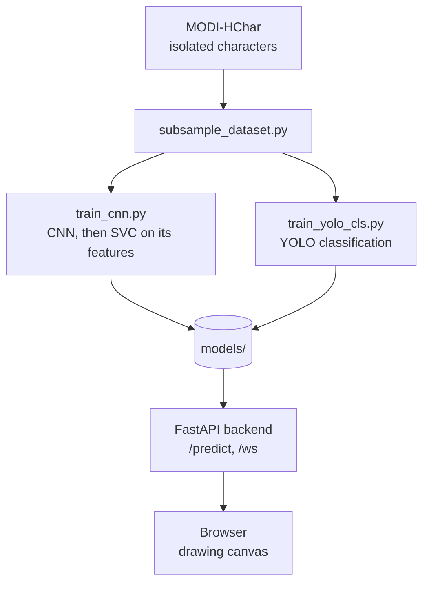

# Architecture



## Components

| Part | Role |
|---|---|
| `training/` | Offline pipeline: subsample, train CNN + SVC, train YOLO classification |
| `backend/ml/` | Inference wrappers (YOLO, CNN + SVC) and shared preprocessing |
| `backend/app/` | FastAPI app: model registry, REST and WebSocket endpoints |
| `frontend/` | Static page: a drawing canvas that posts the drawing and shows the prediction |

## CNN + SVC

1. The CNN (Conv32, Conv64, Dense128, Dense57) is trained with cross-entropy.
2. Its 128-d penultimate layer is used as a feature extractor. Features are standardised (scaler fitted
   on the training set only) and an SVC is fitted on them; kernel and C are chosen on the validation set.
3. The SVC is wrapped in a sigmoid calibrator to give probabilities. The API runs CNN, scaler, SVC in order.

## API

- `GET /health` returns `{"status": "ok"}`.
- `GET /models` returns which models loaded and why any failed.
- `POST /predict/{yolo|cnn_svc}` takes a multipart image `file` and returns a prediction.
- `WS /ws/{yolo|cnn_svc}`: the client sends an image data URL per message, the server replies with one JSON message each (available; the canvas page uses `POST /predict`).

Response shape:

```json
{
  "model": "cnn_svc",
  "text": "ka",
  "detections": [{"label": "ka", "confidence": 0.93, "box": null}],
  "latency_ms": 4.1,
  "image_size": [320, 320]
}
```

Both models return the top 3 labels with `box: null`; `text` is the top-1 label. If detection weights
are loaded as `yolo` in future, the same endpoint returns boxes sorted left to right and `text` joins them.

## Evaluation protocol

Both models share one source-level split (70/15/15) of the same crops. Report: test accuracy,
per-class precision/recall, confusion matrix, CNN-alone vs CNN + SVC accuracy, SVC kernel and C
(train vs validation accuracy for bias/variance), YOLO top-1 and top-5, ms per image, and end-to-end
latency on AWS.
