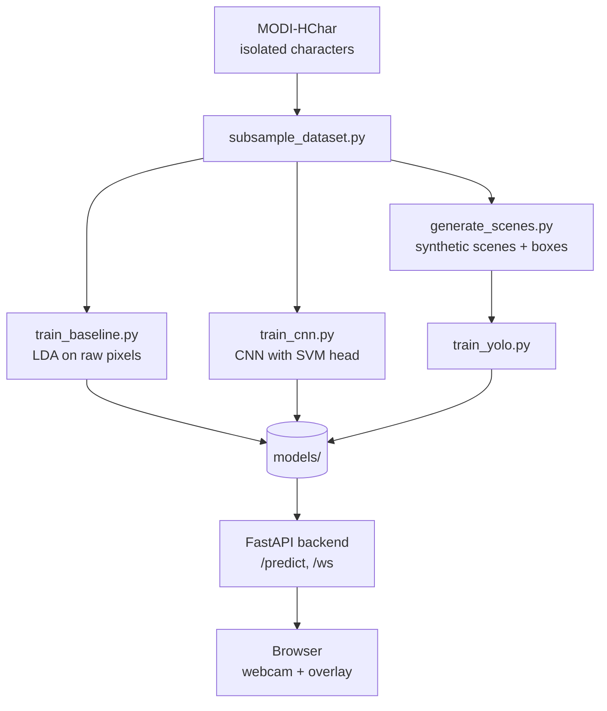

# Architecture



## Components

| Part | Role |
|---|---|
| `training/` | Offline pipeline: subsample, baselines, scene generation, YOLO training |
| `backend/ml/` | Inference wrappers (YOLO, LDA, CNN) and shared preprocessing |
| `backend/app/` | FastAPI app: model registry, REST and WebSocket endpoints |
| `frontend/` | Static page: captures webcam frames, draws returned boxes and text |

## API

- `GET /health` returns `{"status": "ok"}`.
- `GET /models` returns which models loaded and why any failed.
- `POST /predict/{yolo|baseline|cnn}` takes a multipart image `file` and returns a prediction.
- `WS /ws/{yolo|baseline|cnn}`: the client sends a JPEG data URL per frame, the server replies with one JSON message per frame.

Response shape:

```json
{
  "model": "yolo",
  "text": "ka ma",
  "detections": [{"label": "ka", "confidence": 0.93, "box": [x1, y1, x2, y2]}],
  "latency_ms": 42.1,
  "image_size": [640, 480]
}
```

Classifiers (`baseline`, `cnn`) return the top 3 labels with `box: null`; `text` is the top-1 label.
YOLO returns boxes sorted left to right, and `text` joins their labels.

## Evaluation protocol

All models share one source-level split (70/15/15). Report: accuracy, per-class precision/recall,
confusion matrix, LDA projection plot, train-vs-validation accuracy (bias/variance), mAP50 / mAP50-95
for YOLO, ms per image, and end-to-end latency on AWS. The CNN head is ablated (`--head svm` vs
`--head softmax`).
